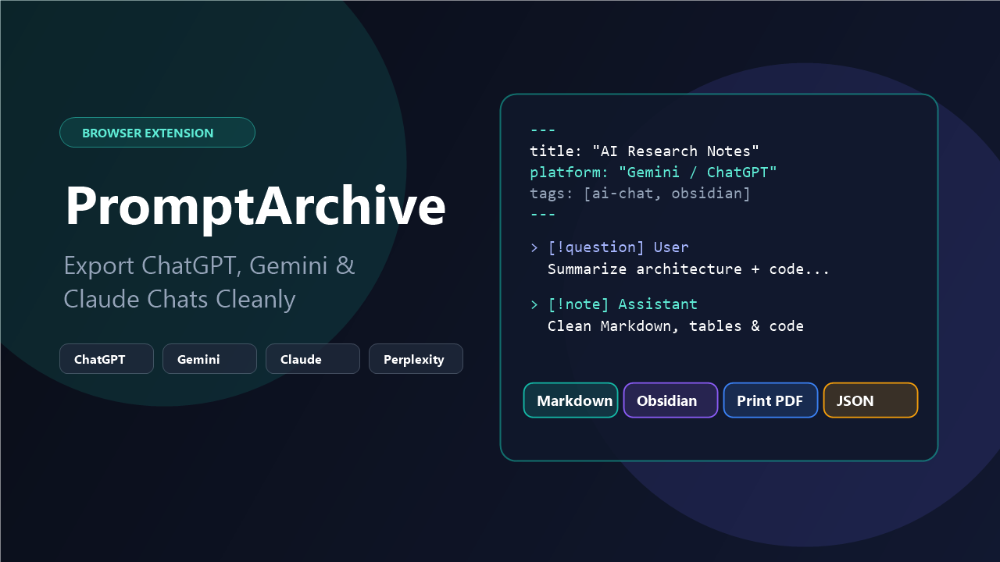

<div align="center">
  
  <h1>PromptArchive — Export ChatGPT, Gemini &amp; Claude Chats</h1>
  <p><strong>100% 本地端多平台 AI 對話乾淨匯出器：一鍵將 ChatGPT、Gemini、Claude、Perplexity 對話轉存為 Markdown、Obsidian 筆記、乾淨列印 PDF 與 JSON</strong></p>
  <p>Export ChatGPT, Gemini, Claude &amp; Perplexity conversations cleanly to Markdown, Obsidian (YAML + Callouts), Print-Ready HTML/PDF, or JSON — 100% local &amp; private.</p>

  <p>
    <a href="https://eggcellent20.gumroad.com/l/pbmaws"><strong>Get PromptArchive Pro ($12 Lifetime)</strong></a> ·
    <a href="https://egg9372000.github.io/promptarchive/"><strong>Website</strong></a> ·
    <a href="https://egg9372000.github.io/promptarchive/privacy.html"><strong>Privacy Policy</strong></a>
  </p>

  
</div>

---

> 🌐 **Language / 語言切換**：[繁體中文](#繁體中文介紹) | [English](#english-overview)

---

## 繁體中文介紹

### 為什麼做 PromptArchive？

重度 AI 使用者常遇到三大痛點：**Google Gemini 沒有原生一鍵匯出整段對話成 Markdown/PDF**、現有第三方匯出外掛動不動因改版匯出空白、以及手動 `Ctrl+A` 複製長對話容易漏截或夾雜一堆 `Copy code` / 按讚按鈕垃圾文字。

**PromptArchive** 解決方案：
- **多平台自適應＋通用備援引擎**：支援 **ChatGPT、Gemini、Claude、Perplexity**，並內建語意與選取文字通用備援，絕不輸出空白檔。
- **乾淨還原結構**：精準保留程式碼區塊語言標記（` ```python `）、Markdown 表格、標題與列表，自動剔除雜訊按鈕。
- **勾選指定回合匯出**：匯出前可取消勾選不要的回合，讓筆記庫保持高信噪比。
- **Obsidian 專屬格式與列印 PDF（Pro）**：自動產生含 `title`、`platform`、`source`、`tags` 的 YAML Frontmatter 與 Callout 區塊，或輸出排版精美的乾淨 HTML 直接 `Ctrl+P` 另存 PDF。

### 免費版 vs. Pro 買斷版

| 功能 | 免費版（Free） | Pro 終身買斷版（$12 一次性） |
|---|:---:|:---:|
| 自動偵測 ChatGPT / Gemini / Claude / Perplexity 對話並勾選回合 | ✅ | ✅ |
| 複製乾淨 Markdown / 下載 `.md` | ✅（前 10 回合） | ✅ **無限回合長對話** |
| **Obsidian 專屬筆記（YAML Frontmatter + Callouts）** | — | ✅ |
| **乾淨列印 / PDF 專用 HTML & 結構化 JSON 備份** | — | ✅ |
| 100% 瀏覽器本地端轉換、絕不上傳對話隱私 | ✅ | ✅ |

---

## English Overview

### Why PromptArchive?

Google Gemini lacks a native standalone conversation export button, legacy ChatGPT exporters frequently output blank files after UI changes, and manual copy-pasting loses formatting or includes stray UI buttons.

**PromptArchive** exports your AI chats **100% locally** into clean Markdown, Obsidian notes (YAML frontmatter + callouts), Print-ready HTML/PDF, and structured JSON — with a universal fallback so it never breaks. Read our [Privacy Policy](https://egg9372000.github.io/promptarchive/privacy.html).
